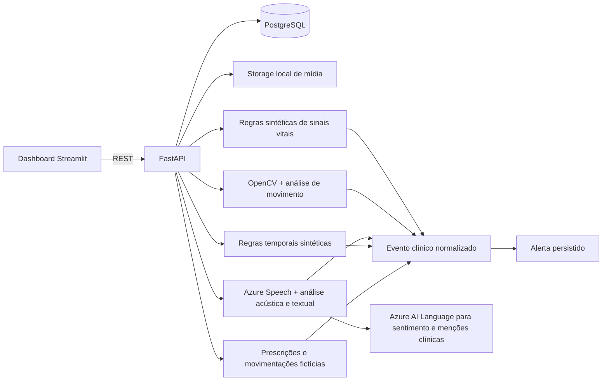

# MedGuard AI

Implementação das Etapas 1 a 4 do Tech Challenge FIAP - Fase 4. O projeto oferece uma API modular em FastAPI, persistência PostgreSQL, dashboard Streamlit e fluxos ponta a ponta de sinais vitais, vídeo, áudio, prescrições e movimentações sintéticas.

> **Uso exclusivamente educacional.** O projeto aceita somente dados fictícios ou sintéticos, não é um dispositivo médico, não oferece diagnóstico e não deve apoiar decisões clínicas reais. Os limites usados no detector são exemplos de software, não referências clínicas universais.

## O que as Etapas 1–4 entregam

- API REST FastAPI com Swagger em `http://localhost:8000/docs`.
- PostgreSQL e ambiente completo via Docker Compose.
- Dashboard Streamlit em `http://localhost:8501`.
- Modelos persistentes para pacientes fictícios, mídia, jobs, medições, prescrições, eventos e alertas.
- Upload controlado de áudio e vídeo fictícios, com hash SHA-256 e job rastreável.
- Primeiro fluxo demonstrável: medição sintética → regras ilustrativas → evento → alerta.
- Processamento real de vídeo com OpenCV, extração de metadados e amostragem de quadros.
- Métricas determinísticas de movimento por diferença entre quadros, sem identificação de pessoas.
- Detecção demonstrativa de baixa movimentação, mudança visual abrupta e inclinação do tronco com OpenPose e YOLOv8 Pose, com eventos, alertas e relatório automático.
- Job de vídeo rastreável nos estados `queued`, `processing`, `completed` e `failed`.
- Vídeo geométrico sintético gerado por código para uma demonstração reproduzível.
- Transcrição de áudio WAV sintético com Azure Speech, sem credenciais no repositório.
- Análise de sentimento da transcrição em português com Azure AI Language, com resultados por sentença.
- Extração de menções a sintomas e sinais da transcrição com Azure Text Analytics for Health, incluindo contexto quando disponível.
- Métricas acústicas locais de duração, RMS, pico, silêncio e clipping.
- Análise textual determinística com tratamento de negação, contexto histórico e terceiros.
- Eventos de revisão humana para achados afirmativos, sem alerta ou diagnóstico automático.
- Correlação temporal preliminar entre eventos sintéticos de áudio e sinais vitais.
- Análise temporal das quatro medições sintéticas mais recentes, com regras transparentes para tendências de frequência cardíaca, SpO2 e pressão sistólica.
- Verificação demonstrativa da sequência de prescrições fictícias, incluindo início duplicado e alteração ou encerramento sem registro ativo.
- Verificação demonstrativa da continuidade de movimentações fictícias, incluindo origem/destino iguais, quebra de continuidade e transferências muito próximas.
- Eventos e alertas rastreáveis para anomalias temporais e operacionais, sempre sujeitos a revisão humana.
- Testes básicos da API, proteção contra dados não sintéticos, alertas e upload.

## Arquitetura



O desenho é um monólito modular: fácil de executar agora e com limites claros para substituir cada processador por implementação assíncrona nas etapas seguintes.

## Estrutura principal

```text
app/
  api/routes/        endpoints REST
  core/              configuração
  db/                modelos SQLAlchemy
  modules/audio/     Azure Speech, Azure AI Language, análise acústica e regras textuais
  modules/video/     leitura de quadros e análise de movimento com OpenCV
  schemas/           validação e contratos da API
  services/          fluxos multimodais, temporais e operacionais até eventos/alertas
dashboard/           interface Streamlit
samples/             dados sintéticos de exemplo
storage/uploads/     mídia local ignorada pelo Git
tests/               testes automatizados
```

## Execução recomendada com Docker

Pré-requisitos: Docker Desktop e Docker Compose.

1. Crie o arquivo local de ambiente:

   PowerShell:

   ```powershell
   Copy-Item .env.example .env
   ```

   Linux/macOS:

   ```bash
   cp .env.example .env
   ```

2. Suba todos os serviços:

   ```bash
   docker compose up --build
   ```

3. Abra:

   - Dashboard: <http://localhost:8501>
   - Swagger: <http://localhost:8000/docs>
   - Health check: <http://localhost:8000/health>

4. Encerre sem apagar o banco:

   ```bash
   docker compose down
   ```

Para recriar também o volume PostgreSQL, use `docker compose down -v`. Isso apaga os dados locais do projeto.

## Configurar os recursos do Azure

O fluxo de áudio usa dois recursos. **Azure Speech** transcreve a gravação. **Azure AI Language** analisa o sentimento e extrai menções clínicas com Text Analytics for Health. Com recursos compatíveis já criados, siga diretamente para a configuração do `.env`.

### Criar os recursos

No [portal Azure](https://portal.azure.com/), use **Criar um recurso** para provisionar **Speech** e **Language**. Selecione a assinatura, o grupo de recursos, uma região compatível e o plano. Para Language, use um recurso que aceite Text Analytics for Health. Aguarde a conclusão das duas implantações. [Guia do Azure Speech](https://learn.microsoft.com/en-us/azure/ai-services/speech-service/captioning-quickstart) · [Guia do Text Analytics for Health](https://learn.microsoft.com/en-us/azure/ai-services/language-service/text-analytics-for-health/quickstart)

Para criar pelo PowerShell, instale o Azure CLI, entre na sua conta e substitua `<ID-da-assinatura>` pelo ID da assinatura que usará. O registro do provedor também resolve o erro `MissingSubscriptionRegistration`. [Instalação do Azure CLI no Windows](https://learn.microsoft.com/pt-br/cli/azure/install-azure-cli-windows) · [Registro de provedores](https://learn.microsoft.com/en-us/cli/azure/provider#az-provider-register)

```powershell
az login
az account list --query "[].{Assinatura:name,SubscriptionId:id}" -o table
az account set --subscription "<ID-da-assinatura>"
az provider register --namespace Microsoft.CognitiveServices --wait
```

Crie os recursos após a conclusão do registro. O exemplo usa `eastus` e solicita o plano gratuito `F0`, sujeito à disponibilidade e à cota da assinatura. [Referência do Azure CLI](https://learn.microsoft.com/en-us/cli/azure/cognitiveservices/account#az-cognitiveservices-account-create)

```powershell
$grupo = "rg-medguard-demo"
$regiao = "eastus"
$sufixo = Get-Random -Minimum 100000 -Maximum 1000000
$speech = "medguard-speech-$sufixo"
$language = "medguard-language-$sufixo"

az group create -n $grupo -l $regiao -o none
az cognitiveservices account create -g $grupo -n $speech -l $regiao --kind SpeechServices --sku F0 -o none
az cognitiveservices account create -g $grupo -n $language -l $regiao --kind TextAnalytics --sku F0 --custom-domain $language -o none
```

### Preencher o .env

No portal, abra **Todos os recursos**, selecione cada recurso e vá para **Chaves e ponto de extremidade**. Na raiz do projeto, copie `.env.example` para `.env` se o arquivo ainda não existir. Preencha os campos conforme a tabela.

| Variável | Valor |
|---|---|
| `AZURE_SPEECH_KEY` | Chave 1 ou 2 do recurso Speech |
| `AZURE_SPEECH_REGION` | Código da região desse recurso, por exemplo `eastus` |
| `AZURE_LANGUAGE_ENDPOINT` | URL HTTPS do endpoint do recurso Language |
| `AZURE_LANGUAGE_KEY` | Chave 1 ou 2 do mesmo recurso Language |

Mantenha as chaves no `.env` local, ignorado pelo Git. Execute `docker compose up -d --build` na raiz do projeto para aplicar a configuração. Depois, siga o [roteiro com áudio sintético](#áudio-sintético-e-sentimento) para validar a integração.

## Demonstrações

No dashboard, use **Pacientes** para cadastrar ou buscar um paciente fictício. Selecione o paciente e abra seu prontuário. Em **Mídias e análises**, escolha um arquivo para consultar e processar os jobs associados. A aba também permite reproduzir WAV e MP4 compatíveis com o navegador ou baixar o arquivo original. Os registros de sinais vitais, prescrições, movimentações, eventos e alertas ficam nas demais abas do prontuário.

### Áudio sintético e sentimento

1. [Configure os recursos do Azure](#configurar-os-recursos-do-azure) e inicie o Docker Compose.
2. Gere áudios curtos com voz sintetizada em português do Brasil e exporte em WAV PCM de 16 bits. Use apenas frases inventadas. O Azure Speech reconhece uma única fala por arquivo neste fluxo, então evite pausas longas entre as frases. [Reconhecimento de fala única](https://learn.microsoft.com/python/api/azure-cognitiveservices-speech/azure.cognitiveservices.speech.speechrecognizer)

   Exemplos para exercitar diferentes tons:

   | Tom do exemplo | Frase sintética |
   |---|---|
   | Positivo | Adorei o passeio. Foi maravilhoso. |
   | Neutro | A sala fica no segundo andar. |
   | Negativo | O passeio foi horrível. |
   | Misto | Adorei o passeio. A comida foi péssima. |

3. Abra o prontuário de um paciente fictício, envie um WAV em **Mídias e análises** e selecione o arquivo. Clique em **Processar mídia** e confira a transcrição, a identificação do Azure AI Language, o sentimento geral, os três escores e a tabela de sentenças quando disponível. Os rótulos e os escores podem variar com a transcrição e com o modelo.
4. Consulte `GET /api/v1/jobs/{id}` no Swagger. Em `result.analysis.sentiment_analysis`, confira `provider: azure_ai_language`, `language: pt-BR`, `status: succeeded`, `sentiment`, `confidence_scores` e `sentences`. Atualize o dashboard e selecione o mesmo job para conferir a leitura do resultado persistido. O exemplo negativo isolado mantém `alert_ids` vazio.
5. Para verificar a degradação, deixe `AZURE_LANGUAGE_KEY` vazia, mantenha o Speech configurado, aplique a configuração e processe um novo job. O job deve concluir com transcrição, métricas acústicas e regras locais, e o painel deve indicar `unavailable` com motivo `missing_configuration`. Um áudio sem fala reconhecida deve exibir `skipped`. A API bloqueia o reprocessamento de jobs concluídos.

O Azure AI Language classifica o tom do texto transcrito como positivo, neutro, negativo ou misto. Os escores representam a confiança do modelo na classificação, entre 0 e 1. O resultado tem finalidade educacional. Um tom negativo não indica risco clínico, dor, depressão ou emergência. Os escores não estimam a probabilidade de doença e o sentimento não gera alertas clínicos.

`analysis.text_analysis` registra a identificação de termos críticos por regras locais. Por exemplo, a frase fictícia “Estou com dor” pode acionar `requires_review` nessa análise mesmo com o sentimento indisponível. As métricas de áudio ficam em `analysis.acoustic`.

O adaptador usa `TextAnalyticsClient.analyze_sentiment` com um documento por chamada e solicita a desativação dos logs de entrada no serviço. Transcrições acima de 5.120 elementos de texto Unicode ou que excedam o tamanho da requisição síncrona de 1 MB ficam com `unavailable` e motivo `document_too_large`. A aplicação preserva o texto completo. Texto vazio ou fala sem reconhecimento ficam com `skipped` e dispensam a chamada. Erros de serviço, rejeições do documento e respostas inesperadas ficam com `unavailable` e um código de motivo seguro. O dashboard exibe a origem Azure somente para resultados com `succeeded`. [SDK oficial](https://learn.microsoft.com/en-us/python/api/overview/azure/ai-textanalytics-readme) · [Limites do serviço](https://learn.microsoft.com/en-us/azure/ai-services/language-service/concepts/data-limits)

A Microsoft anunciou a descontinuação dessa funcionalidade do Azure Language para 31 de março de 2029. [Ciclo de vida da funcionalidade](https://learn.microsoft.com/en-us/azure/ai-services/language-service/sentiment-opinion-mining/overview?tabs=prebuilt)

### Menções clínicas na transcrição

A análise usa o mesmo endpoint e a mesma chave do Azure AI Language, em um recurso que aceite Text Analytics for Health. A API envia a transcrição sintética em português (`pt`) com os logs de entrada desativados e guarda entidades da categoria `SymptomOrSign` em `result.analysis.clinical_mentions`. Cada menção inclui o trecho, a posição e o comprimento no texto, a categoria, a confiança da extração e os modificadores de certeza, associação e condicionalidade retornados pelo SDK. Um campo vazio indica ausência de modificador explícito. [Configuração do recurso](https://learn.microsoft.com/en-us/azure/ai-services/language-service/text-analytics-for-health/quickstart) · [Contexto das entidades](https://learn.microsoft.com/en-us/azure/ai-services/language-service/text-analytics-for-health/concepts/assertion-detection)

Para validar, gere e processe WAVs sintéticos curtos com “Estou com falta de ar”, “Não estou com falta de ar” e “Minha irmã está com falta de ar”. Compare os trechos e o contexto em **Mídias e análises** e no job consultado via `GET /api/v1/jobs/{id}`. Confira a marca de negação no segundo exemplo e a associação no terceiro quando o serviço a retornar. Use “O passeio foi horrível” para exercitar uma resposta sem menções a sintomas.

Uma resposta sem sintomas tem status `succeeded` e lista vazia. Sem fala reconhecida ou com texto vazio, a extração fica `skipped`. Configuração ausente, erro do Azure, documento acima dos limites ou operação que exceda 20 segundos recebem `unavailable` com motivo seguro. O job registra as demais análises disponíveis. Os eventos de revisão continuam baseados nas regras locais. As menções extraídas são educacionais e os escores medem a confiança na extração do trecho.

### Séries temporais e operações — Etapa 4

No prontuário de um paciente fictício, abra **Prescrições e movimentações** e registre sequências deliberadamente inconsistentes. Para demonstrar uma tendência de sinais vitais, use a aba **Sinais vitais** e registre quatro medições sintéticas com valores crescentes de frequência cardíaca, por exemplo `70`, `82`, `94` e `106` bpm.

A aplicação:

1. analisa uma janela recente de quatro medições sintéticas;
2. registra eventos para tendências configuradas e transparentes;
3. compara cada ação de prescrição fictícia com o último estado do mesmo código;
4. compara cada movimentação fictícia com o destino anterior;
5. cria alertas demonstrativos e mantém no evento os motivos que exigem revisão humana.

As regras comprovam o fluxo de software e não representam limites clínicos, validação farmacológica ou rastreamento real.

### Áudio — Etapa 3

Na aba **Mídias e análises** do prontuário, envie um WAV inteiramente sintético e processe o job associado. A aplicação:

1. valida o paciente e a mídia sintéticos;
2. transcreve o WAV em português com Azure Speech;
3. calcula métricas acústicas locais;
4. aplica regras textuais contextuais;
5. persiste eventos de revisão humana, sem criar diagnóstico ou alerta clínico automático.

As credenciais `AZURE_SPEECH_KEY` e `AZURE_SPEECH_REGION` devem existir apenas no arquivo local `.env`.

### Vídeo — Etapa 2

Para ativar a análise de postura, siga [Preparar os modelos de postura](#preparar-os-modelos-de-postura). No dashboard, abra **Demonstrações**, escolha **Inclinação do tronco** ou **Baixa movimentação** e clique em **Executar demonstração de vídeo**. A aplicação:

1. cria um paciente fictício específico da demonstração;
2. gera um AVI identificado como `SYNTHETIC`, com formas geométricas ou uma figura humana fictícia;
3. registra a mídia e o job;
4. decodifica e amostra quadros com OpenCV;
5. calcula a porcentagem de pixels alterados entre quadros e, com os pesos disponíveis, estima a postura;
6. persiste os eventos e alertas produzidos pelas regras educacionais e gera um relatório por job.

Para analisar um arquivo seu, abra o prontuário de um paciente fictício, vá a **Mídias e análises → Adicionar áudio ou vídeo**, escolha um vídeo sintético (MP4, MOV, AVI ou MKV) e clique em **Enviar e analisar**. O dashboard seleciona o arquivo enviado e mostra o resultado no prontuário. Use **Apenas registrar** para deixar a mídia na fila e processá-la mais tarde.

Selecione **Baixar relatório de vídeo** para obter um arquivo de texto com as métricas, os desvios e seus trechos. O relatório fica associado ao vídeo e pode ser consultado novamente na lista de mídias do paciente.

O mesmo fluxo pode ser executado pela API:

```bash
curl -X POST http://localhost:8000/api/v1/demo/video-alert
curl -X POST "http://localhost:8000/api/v1/demo/video-alert?scenario=posture"
```

#### Preparar os modelos de postura

Na raiz do projeto, baixe os arquivos em `storage/models`. O Docker Compose monta `storage` no container da API. Os modelos executam em CPU com OpenCV DNN. Os pesos ficam na pasta local ignorada pelo Git. O download inclui o modelo COCO do OpenPose e uma exportação ONNX do YOLOv8n Pose. [OpenPose COCO](https://github.com/CMU-Perceptual-Computing-Lab/openpose/blob/master/CMakeLists.txt) · [YOLOv8 Pose](https://docs.ultralytics.com/models/yolov8) · [Exportação ONNX](https://huggingface.co/Xenova/yolov8-pose-onnx/blob/393fd46/yolov8n-pose.onnx)

```powershell
New-Item -ItemType Directory -Path storage/models -Force | Out-Null

curl.exe --fail --location --output storage/models/pose_deploy_linevec.prototxt "https://raw.githubusercontent.com/CMU-Perceptual-Computing-Lab/openpose/5c5d96523ef917bd30301245fdc8343937cae48d/models/pose/coco/pose_deploy_linevec.prototxt"
curl.exe --fail --location --output storage/models/pose_iter_440000.caffemodel "https://huggingface.co/camenduru/openpose/resolve/main/models/pose/coco/pose_iter_440000.caffemodel"
curl.exe --fail --location --output storage/models/yolov8n-pose.onnx "https://huggingface.co/Xenova/yolov8-pose-onnx/resolve/393fd46/yolov8n-pose.onnx"

Get-FileHash -Algorithm SHA256 storage/models/pose_deploy_linevec.prototxt, storage/models/pose_iter_440000.caffemodel, storage/models/yolov8n-pose.onnx
```

| Arquivo | SHA-256 esperado |
|---|---|
| `pose_deploy_linevec.prototxt` | `17051B87F709AA094E09C5DA7B78E9016A1F37B2B452ED1F190FE74CCE70B1AD` |
| `pose_iter_440000.caffemodel` | `B4CF475576ABD7B15D5316F1EE65EB492B5C9F5865E70A2E7882ED31FB682549` |
| `yolov8n-pose.onnx` | `04F6D2416266F2ABA6C5BA8B26DE33ED9EBA3279F972AC02E33F9F1366547586` |

Confira os hashes e rode `docker compose up -d --build`. Com os arquivos disponíveis, a demonstração **Inclinação do tronco** gera um vídeo curto a partir de uma imagem sintética com postura inclinada. Para enviar seu próprio vídeo de teste em **Mídias e análises**, use um vídeo fictício de uma única pessoa com ombros e quadris visíveis. [Licença do OpenPose](https://github.com/CMU-Perceptual-Computing-Lab/openpose/blob/master/LICENSE) · [Licença da exportação YOLOv8](https://huggingface.co/Xenova/yolov8-pose-onnx)

### Sinais vitais — Etapa 1

No dashboard, abra **Demonstrações** e clique em **Executar demonstração de alerta**. A aplicação:

1. cria ou reutiliza o paciente `MG-DEMO-001`;
2. registra uma medição deliberadamente anômala e sintética;
3. aplica regras ilustrativas;
4. persiste um evento de severidade crítica;
5. cria um alerta aberto;
6. mostra o resultado no painel.

O mesmo fluxo pode ser executado pela API:

```bash
curl -X POST http://localhost:8000/api/v1/demo/vital-alert
```

Depois, consulte:

```bash
curl http://localhost:8000/api/v1/events
curl http://localhost:8000/api/v1/alerts
```

## Endpoints iniciais

| Método | Rota | Finalidade |
|---|---|---|
| `GET` | `/health` | Estado da API |
| `POST/GET` | `/api/v1/patients` | Cadastrar/listar pacientes fictícios |
| `POST` | `/api/v1/patients/{id}/measurements` | Registrar e avaliar medição sintética |
| `GET` | `/api/v1/patients/{id}/measurements` | Consultar medições |
| `POST/GET` | `/api/v1/patients/{id}/prescriptions` | Registrar/listar prescrição fictícia |
| `POST` | `/api/v1/patients/{id}/prescriptions/evaluate` | Registrar e avaliar sequência de prescrição fictícia |
| `POST/GET` | `/api/v1/patients/{id}/movements` | Registrar, avaliar e listar movimentações fictícias |
| `POST` | `/api/v1/patients/{id}/media` | Enviar áudio ou vídeo fictício |
| `GET` | `/api/v1/media` | Consultar mídias, com filtro por paciente e paginação por `offset` e `limit` |
| `GET` | `/api/v1/media/{id}/content` | Baixar mídia sintética pelo ID |
| `GET` | `/api/v1/jobs` | Consultar jobs, com filtro por paciente e paginação por `offset` e `limit` |
| `POST` | `/api/v1/jobs/{id}/process` | Processar um job de áudio ou vídeo pendente |
| `POST` | `/api/v1/patients/{id}/correlations/run` | Correlacionar eventos sintéticos próximos no tempo |
| `GET` | `/api/v1/events` | Consultar eventos normalizados |
| `GET/PATCH` | `/api/v1/alerts` e `/api/v1/alerts/{id}` | Consultar e atualizar alertas |
| `POST` | `/api/v1/demo/vital-alert` | Executar fluxo demonstrável |
| `POST` | `/api/v1/demo/video-alert` | Gerar e analisar vídeo geométrico sintético |

## Upload de mídia nesta etapa

Formatos aceitos:

- Áudio: `.wav` PCM de 16 bits.
- Vídeo: `.mp4`, `.mov`, `.avi`, `.mkv`.

O upload salva o arquivo, calcula o hash, cria `media_files` e registra um `processing_job` com status `queued`. Jobs de áudio e vídeo são processados por `POST /api/v1/jobs/{id}/process`.

### Como a análise de áudio funciona

O adaptador Azure Speech transcreve o WAV sintético em `pt-BR`. Em seguida, o pipeline calcula métricas acústicas e aplica regras contextuais transparentes sobre o texto. Expressões afirmativas podem criar eventos de baixa severidade para revisão humana; não são gerados diagnósticos nem alertas clínicos automáticos. Os testes substituem a chamada Azure por mocks e geram áudio sintético em memória.

### Como a análise de vídeo funciona

O processador reduz cada quadro amostrado para uma matriz em tons de cinza e mede a proporção de pixels cuja intensidade mudou. As regras de movimento geram eventos demonstrativos para movimento médio igual ou inferior a `VIDEO_LOW_MOTION_THRESHOLD` e pico de mudança igual ou superior a `VIDEO_ABRUPT_MOTION_THRESHOLD`. O relatório indica o trecho amostrado no primeiro caso e o intervalo do maior pico no segundo.

Na análise de postura, o YOLOv8 identifica a pessoa e estima os pontos dos ombros e quadris. O OpenPose COCO estima esses pontos na região da mesma pessoa. O sistema mede o ângulo do tronco em relação à vertical da imagem. A regra educacional registra um desvio quando os dois ângulos são de pelo menos **30°** e a diferença entre eles é de até **20°**. Baixa confiança, mais de uma pessoa e divergência de classificação deixam a amostra sem conclusão. Esse ângulo depende do enquadramento e da orientação da câmera.

Os tempos são estimados pelo índice do quadro e FPS do vídeo. Quando o FPS está indisponível, o relatório mostra os quadros. A análise de postura usa até 12 amostras dentro do trecho processado. O sistema persiste os resultados de postura em `result.analysis.pose_analysis`, os desvios em `result.analysis.anomalies` e o relatório em `result.video_report`. Consulte esses campos em `GET /api/v1/jobs/{id}`. Se os modelos estiverem indisponíveis, o relatório informa o motivo e inclui os resultados de movimento.

## Testes

Com os containers ativos:

```bash
docker compose exec api pytest
```

Para executar localmente com Python 3.11+:

```powershell
python -m venv .venv
.\.venv\Scripts\Activate.ps1
python -m pip install -e ".[dev]"
python -m pytest
```

Os testes usam SQLite temporário e mocks para chamadas Azure. O Docker Compose usa PostgreSQL na execução da aplicação.
O workflow `.github/workflows/ci.yml` repete essa validação automaticamente em cada push ou pull request para `main` usando Python 3.12.

## Variáveis de ambiente

Consulte `.env.example` e o [guia de configuração dos recursos do Azure](#configurar-os-recursos-do-azure). Nunca envie chaves, gravações pessoais ou dados médicos reais ao Git.

## Correspondência com o Tech Challenge

| Requisito final | Estado após a Etapa 4 |
|---|---|
| Vídeo clínico e eventos fora do padrão | OpenCV para métricas de movimento, OpenPose e YOLOv8 Pose para inclinação do tronco, com evidências por quadro e relatório automático em vídeos sintéticos |
| Áudio, transcrição e análise textual | Azure Speech, métricas acústicas, regras locais contextuais, sentimento e extração de menções clínicas via Azure AI Language para WAV sintético |
| Anomalias em sinais vitais | Regras pontuais e análise temporal transparente sobre janelas de medições sintéticas |
| Prescrições e movimentação | Detectores demonstrativos de sequência e continuidade implementados com dados fictícios |
| Alertas automáticos | Eventos e alertas persistidos nos fluxos de sinais vitais, vídeo, prescrições e movimentações |
| Fusão multimodal | Correlação temporal preliminar implementada; evolução e validação continuam nas próximas etapas |
| Relatório e vídeo final | Planejados para a Etapa 8 |

## Próximas etapas

1. Ampliar os cenários sintéticos de validação da análise de postura.
2. Ampliar a correlação multimodal e consolidar eventos relacionados em uma linha do tempo.
3. Aprimorar alertas, métricas de qualidade, observabilidade e validação para a entrega final.

