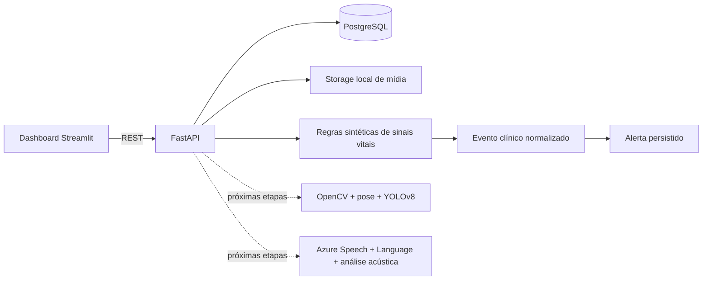

# MedGuard AI

Fundação executável do Tech Challenge FIAP - Fase 4. O projeto implementa uma API modular em FastAPI, persistência PostgreSQL, dashboard Streamlit e um primeiro fluxo ponta a ponta de sinais vitais sintéticos, eventos e alertas.

> **Uso exclusivamente educacional.** O projeto aceita somente dados fictícios ou sintéticos, não é um dispositivo médico, não oferece diagnóstico e não deve apoiar decisões clínicas reais. Os limites usados no detector são exemplos de software, não referências clínicas universais.

## O que esta etapa entrega

- API REST FastAPI com Swagger em `http://localhost:8000/docs`.
- PostgreSQL e ambiente completo via Docker Compose.
- Dashboard Streamlit em `http://localhost:8501`.
- Modelos persistentes para pacientes fictícios, mídia, jobs, medições, prescrições, eventos e alertas.
- Upload controlado de áudio e vídeo fictícios, com hash SHA-256 e job rastreável.
- Primeiro fluxo demonstrável: medição sintética → regras ilustrativas → evento → alerta.
- Módulos de vídeo e áudio preparados, mas explicitamente ainda não executados.
- Variáveis Azure reservadas para as próximas etapas.
- Testes básicos da API, proteção contra dados não sintéticos, alertas e upload.

## Arquitetura



O desenho é um monólito modular: fácil de executar agora e com limites claros para substituir cada processador por implementação assíncrona nas etapas seguintes.

## Estrutura principal

```text
app/
  api/routes/        endpoints REST
  core/              configuração
  db/                modelos SQLAlchemy
  modules/audio/     contrato inicial do pipeline de áudio
  modules/video/     contrato inicial do pipeline de vídeo
  schemas/           validação e contratos da API
  services/          fluxo clínico sintético e regras de anomalia
dashboard/           interface Streamlit
samples/             dados sintéticos de exemplo
storage/uploads/     mídia local ignorada pelo Git
tests/               testes automatizados
```

## Execução recomendada com Docker

Pré-requisitos: Docker Desktop e Docker Compose.

1. Crie o arquivo local de ambiente:

   PowerShell:

   ```powershell
   Copy-Item .env.example .env
   ```

   Linux/macOS:

   ```bash
   cp .env.example .env
   ```

2. Suba todos os serviços:

   ```bash
   docker compose up --build
   ```

3. Abra:

   - Dashboard: <http://localhost:8501>
   - Swagger: <http://localhost:8000/docs>
   - Health check: <http://localhost:8000/health>

4. Encerre sem apagar o banco:

   ```bash
   docker compose down
   ```

Para recriar também o volume PostgreSQL, use `docker compose down -v`. Isso apaga os dados locais do projeto.

## Demonstração em menos de um minuto

No dashboard, abra **Visão geral** e clique em **Executar demonstração de alerta**. A aplicação:

1. cria ou reutiliza o paciente `MG-DEMO-001`;
2. registra uma medição deliberadamente anômala e sintética;
3. aplica regras ilustrativas;
4. persiste um evento de severidade crítica;
5. cria um alerta aberto;
6. mostra o resultado no painel.

O mesmo fluxo pode ser executado pela API:

```bash
curl -X POST http://localhost:8000/api/v1/demo/vital-alert
```

Depois, consulte:

```bash
curl http://localhost:8000/api/v1/events
curl http://localhost:8000/api/v1/alerts
```

## Endpoints iniciais

| Método | Rota | Finalidade |
|---|---|---|
| `GET` | `/health` | Estado da API |
| `POST/GET` | `/api/v1/patients` | Cadastrar/listar pacientes fictícios |
| `POST` | `/api/v1/patients/{id}/measurements` | Registrar e avaliar medição sintética |
| `GET` | `/api/v1/patients/{id}/measurements` | Consultar medições |
| `POST/GET` | `/api/v1/patients/{id}/prescriptions` | Registrar/listar prescrição fictícia |
| `POST` | `/api/v1/patients/{id}/media` | Enviar áudio ou vídeo fictício |
| `GET` | `/api/v1/media` | Consultar mídias |
| `GET` | `/api/v1/jobs` | Consultar jobs |
| `GET` | `/api/v1/events` | Consultar eventos normalizados |
| `GET/PATCH` | `/api/v1/alerts` e `/api/v1/alerts/{id}` | Consultar e atualizar alertas |
| `POST` | `/api/v1/demo/vital-alert` | Executar fluxo demonstrável |

## Upload de mídia nesta etapa

Formatos aceitos:

- Áudio: `.wav`, `.mp3`, `.m4a`, `.ogg`.
- Vídeo: `.mp4`, `.mov`, `.avi`, `.mkv`.

O upload salva o arquivo, calcula o hash, cria `media_files` e registra um `processing_job` com status `queued`. O resultado do job descreve o pipeline futuro como `prepared_not_executed`. Isso evita simular resultados de IA que ainda não foram implementados.

## Testes

Com os containers ativos:

```bash
docker compose exec api pytest
```

Para executar localmente com Python 3.11+:

```bash
python -m venv .venv
python -m pip install -e ".[dev]"
pytest
```

Os testes usam SQLite temporário para permanecerem rápidos e isolados; a execução da aplicação usa PostgreSQL por padrão no Docker Compose.

## Variáveis de ambiente

Consulte `.env.example`. As credenciais Azure estão vazias e reservadas para a futura integração com Azure Speech e Azure AI Language. Nunca envie chaves reais ao Git.

## Correspondência com o Tech Challenge

| Requisito final | Estado após a Etapa 1 |
|---|---|
| Vídeo clínico e eventos fora do padrão | Estrutura, upload e job preparados; implementação na Etapa 2 |
| Áudio, transcrição e análise textual Azure | Estrutura, upload e configuração preparados; implementação na Etapa 3 |
| Anomalias em sinais vitais | Primeiro fluxo por regras sintéticas implementado; modelos temporais na Etapa 4 |
| Prescrições e movimentação | Persistência inicial de prescrições; detectores na Etapa 4 |
| Alertas automáticos | Evento e alerta persistidos no fluxo de sinais vitais |
| Fusão multimodal | Modelo de eventos normalizado preparado; correlação na Etapa 5 |
| Relatório e vídeo final | Planejados para a Etapa 8 |

## Próximas etapas

1. Implementar vídeo de fisioterapia com extração de frames, pose e relatório de desvios.
2. Implementar áudio com Azure Speech, Azure AI Language e características acústicas.
3. Evoluir sinais vitais para séries temporais e adicionar anomalias de prescrições e movimentação.
4. Correlacionar eventos multimodais, aprimorar alertas, métricas e validação.

