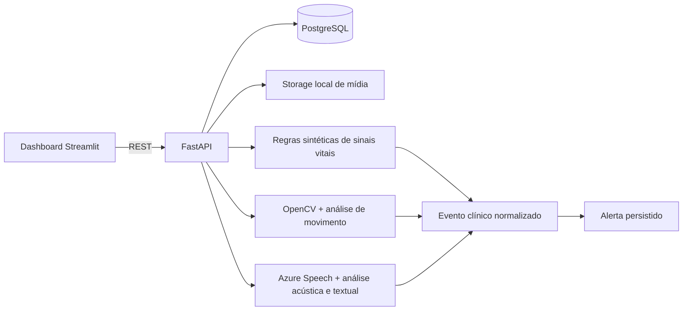

# MedGuard AI

Implementação das Etapas 1, 2 e 3 do Tech Challenge FIAP - Fase 4. O projeto oferece uma API modular em FastAPI, persistência PostgreSQL, dashboard Streamlit e fluxos ponta a ponta de sinais vitais, vídeo e áudio sintéticos.

> **Uso exclusivamente educacional.** O projeto aceita somente dados fictícios ou sintéticos, não é um dispositivo médico, não oferece diagnóstico e não deve apoiar decisões clínicas reais. Os limites usados no detector são exemplos de software, não referências clínicas universais.

## O que as Etapas 1–3 entregam

- API REST FastAPI com Swagger em `http://localhost:8000/docs`.
- PostgreSQL e ambiente completo via Docker Compose.
- Dashboard Streamlit em `http://localhost:8501`.
- Modelos persistentes para pacientes fictícios, mídia, jobs, medições, prescrições, eventos e alertas.
- Upload controlado de áudio e vídeo fictícios, com hash SHA-256 e job rastreável.
- Primeiro fluxo demonstrável: medição sintética → regras ilustrativas → evento → alerta.
- Processamento real de vídeo com OpenCV, extração de metadados e amostragem de quadros.
- Métricas determinísticas de movimento por diferença entre quadros, sem identificação de pessoas.
- Detecção demonstrativa de baixa variação ou mudança visual abrupta → evento → alerta.
- Job de vídeo rastreável nos estados `queued`, `processing`, `completed` e `failed`.
- Vídeo geométrico sintético gerado por código para uma demonstração reproduzível.
- Transcrição de áudio WAV sintético com Azure Speech, sem credenciais no repositório.
- Métricas acústicas locais de duração, RMS, pico, silêncio e clipping.
- Análise textual determinística com tratamento de negação, contexto histórico e terceiros.
- Eventos de revisão humana para achados afirmativos, sem alerta ou diagnóstico automático.
- Correlação temporal preliminar entre eventos sintéticos de áudio e sinais vitais.
- Testes básicos da API, proteção contra dados não sintéticos, alertas e upload.

## Arquitetura



O desenho é um monólito modular: fácil de executar agora e com limites claros para substituir cada processador por implementação assíncrona nas etapas seguintes.

## Estrutura principal

```text
app/
  api/routes/        endpoints REST
  core/              configuração
  db/                modelos SQLAlchemy
  modules/audio/     Azure Speech, análise acústica e regras textuais
  modules/video/     leitura de quadros e análise de movimento com OpenCV
  schemas/           validação e contratos da API
  services/          fluxos de sinais vitais e vídeo até eventos/alertas
dashboard/           interface Streamlit
samples/             dados sintéticos de exemplo
storage/uploads/     mídia local ignorada pelo Git
tests/               testes automatizados
```

## Execução recomendada com Docker

Pré-requisitos: Docker Desktop e Docker Compose.

1. Crie o arquivo local de ambiente:

   PowerShell:

   ```powershell
   Copy-Item .env.example .env
   ```

   Linux/macOS:

   ```bash
   cp .env.example .env
   ```

2. Suba todos os serviços:

   ```bash
   docker compose up --build
   ```

3. Abra:

   - Dashboard: <http://localhost:8501>
   - Swagger: <http://localhost:8000/docs>
   - Health check: <http://localhost:8000/health>

4. Encerre sem apagar o banco:

   ```bash
   docker compose down
   ```

Para recriar também o volume PostgreSQL, use `docker compose down -v`. Isso apaga os dados locais do projeto.

## Demonstrações em menos de um minuto

### Áudio — Etapa 3

Na aba **Mídia e jobs**, envie somente um arquivo WAV inteiramente sintético e marque-o como fictício. Depois, na aba **Análise de áudio**, processe o job. A aplicação:

1. valida o paciente e a mídia sintéticos;
2. transcreve o WAV em português com Azure Speech;
3. calcula métricas acústicas locais;
4. aplica regras textuais contextuais;
5. persiste eventos de revisão humana, sem criar diagnóstico ou alerta clínico automático.

As credenciais `AZURE_SPEECH_KEY` e `AZURE_SPEECH_REGION` devem existir apenas no arquivo local `.env`.

### Vídeo — Etapa 2

No dashboard, abra **Análise de vídeo** e clique em **Executar demonstração de vídeo sintético**. A aplicação:

1. cria um paciente fictício específico da demonstração;
2. gera um arquivo AVI com formas geométricas e a marca `SYNTHETIC`;
3. registra a mídia e o job;
4. decodifica e amostra quadros com OpenCV;
5. calcula a porcentagem de pixels alterados entre quadros;
6. persiste o evento e o alerta produzidos pelas regras educacionais.

O mesmo fluxo pode ser executado pela API:

```bash
curl -X POST http://localhost:8000/api/v1/demo/video-alert
```

### Sinais vitais — Etapa 1

No dashboard, abra **Visão geral** e clique em **Executar demonstração de alerta**. A aplicação:

1. cria ou reutiliza o paciente `MG-DEMO-001`;
2. registra uma medição deliberadamente anômala e sintética;
3. aplica regras ilustrativas;
4. persiste um evento de severidade crítica;
5. cria um alerta aberto;
6. mostra o resultado no painel.

O mesmo fluxo pode ser executado pela API:

```bash
curl -X POST http://localhost:8000/api/v1/demo/vital-alert
```

Depois, consulte:

```bash
curl http://localhost:8000/api/v1/events
curl http://localhost:8000/api/v1/alerts
```

## Endpoints iniciais

| Método | Rota | Finalidade |
|---|---|---|
| `GET` | `/health` | Estado da API |
| `POST/GET` | `/api/v1/patients` | Cadastrar/listar pacientes fictícios |
| `POST` | `/api/v1/patients/{id}/measurements` | Registrar e avaliar medição sintética |
| `GET` | `/api/v1/patients/{id}/measurements` | Consultar medições |
| `POST/GET` | `/api/v1/patients/{id}/prescriptions` | Registrar/listar prescrição fictícia |
| `POST` | `/api/v1/patients/{id}/media` | Enviar áudio ou vídeo fictício |
| `GET` | `/api/v1/media` | Consultar mídias |
| `GET` | `/api/v1/jobs` | Consultar jobs |
| `POST` | `/api/v1/jobs/{id}/process` | Processar um job de áudio ou vídeo pendente |
| `POST` | `/api/v1/patients/{id}/correlations/run` | Correlacionar eventos sintéticos próximos no tempo |
| `GET` | `/api/v1/events` | Consultar eventos normalizados |
| `GET/PATCH` | `/api/v1/alerts` e `/api/v1/alerts/{id}` | Consultar e atualizar alertas |
| `POST` | `/api/v1/demo/vital-alert` | Executar fluxo demonstrável |
| `POST` | `/api/v1/demo/video-alert` | Gerar e analisar vídeo geométrico sintético |

## Upload de mídia nesta etapa

Formatos aceitos:

- Áudio: `.wav` PCM de 16 bits.
- Vídeo: `.mp4`, `.mov`, `.avi`, `.mkv`.

O upload salva o arquivo, calcula o hash, cria `media_files` e registra um `processing_job` com status `queued`. Jobs de áudio e vídeo são processados por `POST /api/v1/jobs/{id}/process`.

### Como a análise de áudio funciona

O adaptador Azure Speech transcreve o WAV sintético em `pt-BR`. Em seguida, o pipeline calcula métricas acústicas e aplica regras contextuais transparentes sobre o texto. Expressões afirmativas podem criar eventos de baixa severidade para revisão humana; não são gerados diagnósticos nem alertas clínicos automáticos. Os testes substituem a chamada Azure por mocks e geram áudio sintético em memória.

### Como a análise funciona

O processador reduz cada quadro amostrado para uma matriz em tons de cinza e mede a proporção de pixels cuja intensidade mudou. Duas regras configuráveis criam eventos demonstrativos:

- movimento médio abaixo de `VIDEO_LOW_MOTION_THRESHOLD`;
- pico de mudança acima de `VIDEO_ABRUPT_MOTION_THRESHOLD`.

Esses indicadores não representam postura, dor, queda, condição clínica nem identidade. São métricas visuais genéricas para comprovar o pipeline de software com dados sintéticos. MediaPipe/YOLO podem ser adicionados posteriormente como analisadores opcionais, mantendo o mesmo contrato de eventos.

## Testes

Com os containers ativos:

```bash
docker compose exec api pytest
```

Para executar localmente com Python 3.11+:

```bash
python -m venv .venv
python -m pip install -e ".[dev]"
pytest
```

Os testes usam SQLite temporário para permanecerem rápidos e isolados; a execução da aplicação usa PostgreSQL por padrão no Docker Compose.
O workflow `.github/workflows/ci.yml` repete essa validação automaticamente em cada push ou pull request para `main` usando Python 3.12.

## Variáveis de ambiente

Consulte `.env.example`. Para processar áudio fora dos testes, configure localmente `AZURE_SPEECH_KEY` e `AZURE_SPEECH_REGION`. Nunca envie chaves, gravações pessoais ou dados médicos reais ao Git.

## Correspondência com o Tech Challenge

| Requisito final | Estado após a Etapa 3 |
|---|---|
| Vídeo clínico e eventos fora do padrão | Pipeline OpenCV, métricas de movimento, eventos e alertas demonstrativos implementados com vídeo sintético |
| Áudio, transcrição e análise textual | Azure Speech, métricas acústicas e análise textual determinística implementados para WAV sintético |
| Anomalias em sinais vitais | Primeiro fluxo por regras sintéticas implementado; modelos temporais na Etapa 4 |
| Prescrições e movimentação | Persistência inicial de prescrições; detectores na Etapa 4 |
| Alertas automáticos | Eventos e alertas persistidos nos fluxos de sinais vitais e vídeo |
| Fusão multimodal | Correlação temporal preliminar implementada; evolução e validação continuam nas próximas etapas |
| Relatório e vídeo final | Planejados para a Etapa 8 |

## Próximas etapas

1. Evoluir sinais vitais para séries temporais e adicionar anomalias de prescrições e movimentação.
2. Evoluir o analisador de vídeo com pose opcional e validação sobre material inteiramente sintético.
3. Ampliar a correlação multimodal, aprimorar alertas, métricas e validação.

