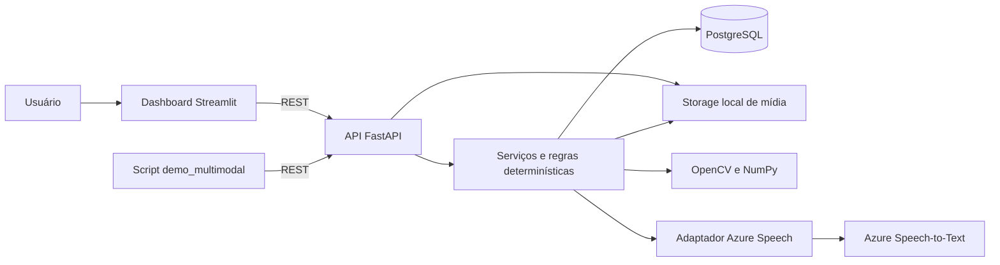
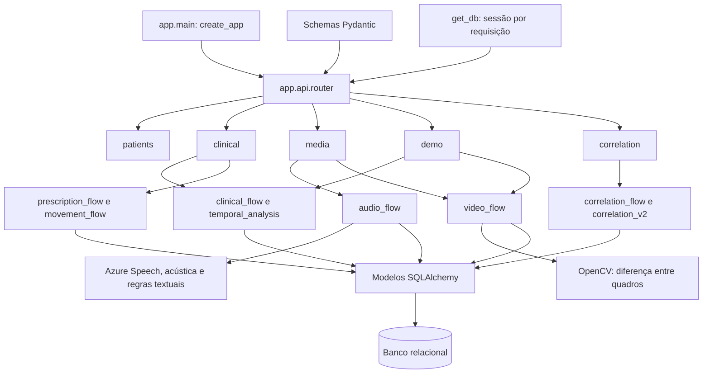
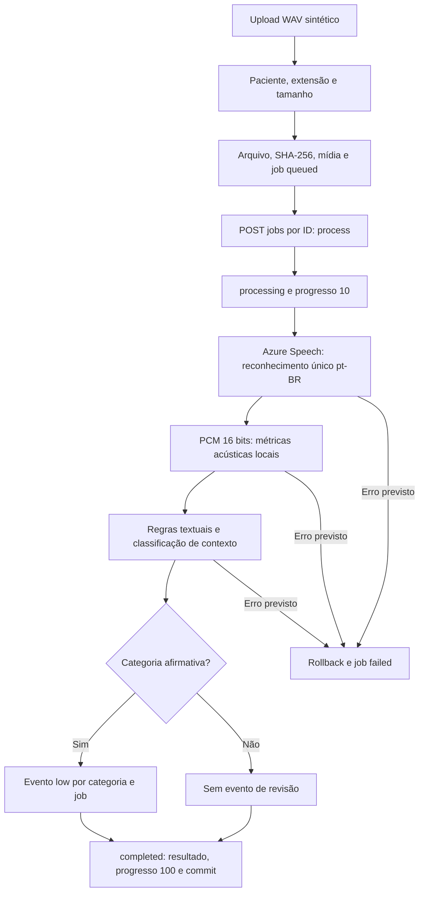
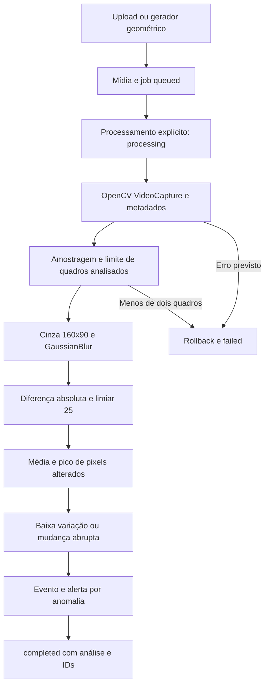
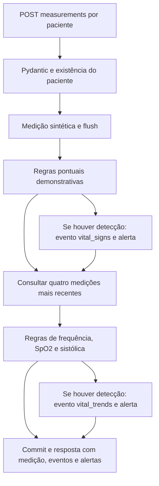
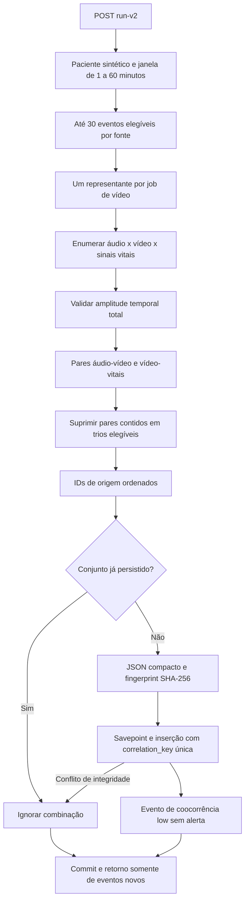
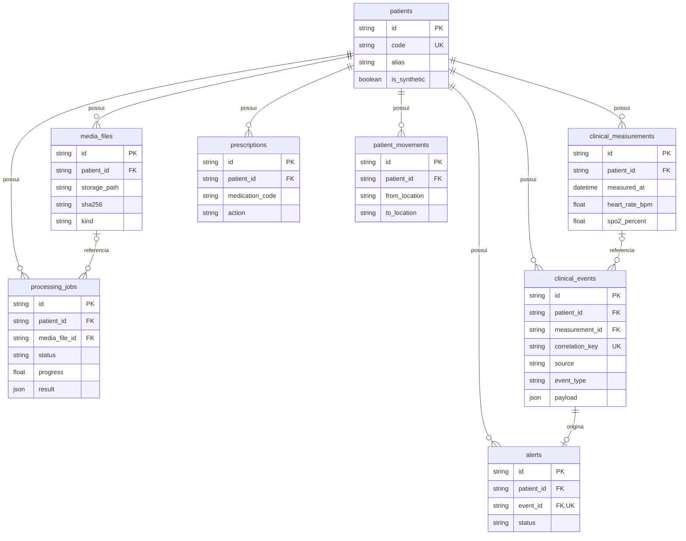
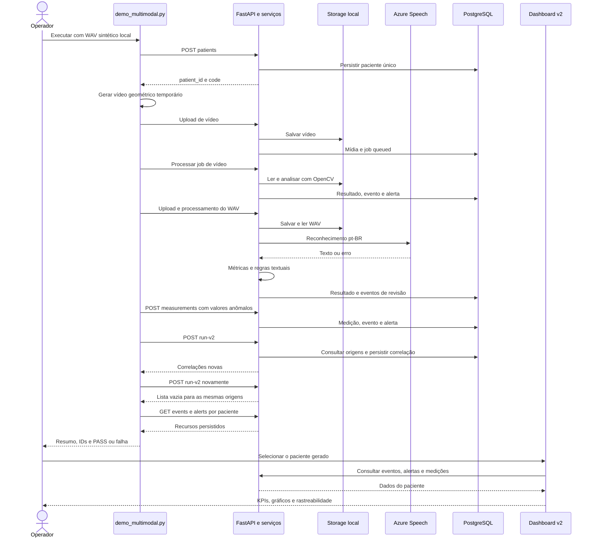

# Diagramas da implementação

[README](../README.md) · [Arquitetura](ARCHITECTURE.md)

Os diagramas usam Mermaid para visualização no GitHub. Representam dados sintéticos e processamento síncrono. Setas indicam chamadas ou fluxo de dados; não indicam causalidade clínica.

## 1. Arquitetura geral

## 2. Componentes e integrações

## 3. Processamento de áudio

O áudio não cria alertas. `NoMatch` pode concluir sem eventos. Detalhes em [Arquitetura](ARCHITECTURE.md#3-áudio-azure-speech-e-análise-local).

## 4. Processamento de vídeo

Ausência de anomalia permite conclusão sem eventos/alertas. Não há reconhecimento de pessoas.

## 5. Ingestão de sinais vitais

## 6. Correlação multimodal v2

A janela é a diferença entre o primeiro e o último evento do conjunto. A v2 não cria par áudio–sinais vitais sem vídeo; esse par pertence à v1.

## 7. Entidades persistidas

Modelo simplificado: campos opcionais e demais métricas estão em [models.py](../app/db/models.py). IDs de origem em payloads não são FKs; o arquivo binário não fica no banco.

## 8. Sequência da demonstração multimodal

O fluxo de sucesso depende do WAV, reconhecimento, limiares e proximidade temporal. Contagens históricas e condições de reprodução estão no [guia](DEMO_GUIDE.md).
